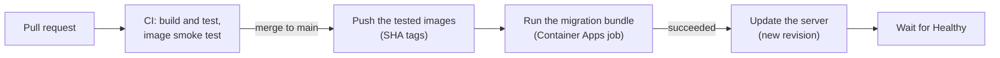

# Todo

A deliberately small .NET todo app with a production-grade delivery path: tested against a real SQL Server and built by GitHub Actions on every pull request, containerized with Docker, deployed to Azure Container Apps with no stored secrets, observable through Application Insights, and changed safely while live. The engineering is in how it ships.

> **Status:** the app ran on Azure Container Apps, reachable only from my own IP address: it has no sign-in, and anyone could write to its home page. Its Azure resources have since been deleted. [`docs/checklist.md`](docs/checklist.md) has every step to recreate them. The workflow still has its push and deploy jobs, which would work again once the resources and the repo's variables are recreated.

## What's here

- **The app:** todo lists and their items. A Blazor Web App with global WebAssembly interactivity: an ASP.NET Core server prerenders each page and serves the client, and the client then calls the server's minimal APIs. EF Core over SQL Server locally and Azure SQL in production.
- **Tests:** xUnit v3 integration tests through `WebApplicationFactory`, against a real SQL Server that Testcontainers starts for the run.
- **Containers:** a multi-stage Dockerfile building two images from one build, the server and an EF Core migration bundle; Docker Compose runs SQL Server, then the migrations, then the server.
- **CI/CD:** every pull request builds, tests and smoke-tests the images, and `main` accepts changes only through pull requests whose checks pass. While the app ran on Azure, a merge to `main` pushed the images it tested, tagged with the commit SHA, ran the migrations, and only then deployed the server, through a GitHub `production` environment.
- **Azure, while it ran:** Container Registry, Container Apps (the server and a migration job), Azure SQL serverless with Entra-only authentication, a managed identity per workload, GitHub Actions signing in through OIDC federation (no stored secrets), and Application Insights through OpenTelemetry.

How a merge reached production while the app ran on Azure:



## Where to read more

- [`docs/adr/`](docs/adr/README.md): the design decisions, each with the options considered and why one won.
- [`docs/checklist.md`](docs/checklist.md): every step of shipping it, with the commands, the settings chosen and what went wrong. Section G replaces a column on the live database over four releases (expand and contract), and E3 rolls a deploy back.
- [`docs/design.md`](docs/design.md): the design note written before the build, updated where the app turned out differently.

## Run it locally

Needs the .NET 10 SDK and Docker. After cloning:

```bash
dotnet tool restore
git config core.hooksPath .githooks
```

**The production images, with their own SQL Server:** copy `.env.example` to `.env` and set a strong password, then run the command below and open http://localhost:8080.

```bash
docker compose up -d --build
```

**The development loop:** run SQL Server in a container, give the app its connection string as a user secret, create the database, and run the app at http://localhost:5007.

```bash
docker run -d --name todo-sql -e ACCEPT_EULA=Y -e MSSQL_SA_PASSWORD='<password>' -p 14333:1433 -v todo-sql-data:/var/opt/mssql mcr.microsoft.com/mssql/server:2025-CU10-ubuntu-24.04
```

```bash
dotnet user-secrets set ConnectionStrings:Todo "Server=localhost,14333;Database=Todo;User Id=sa;Password=<password>;TrustServerCertificate=True" --project src/Todo.Api
```

```bash
dotnet ef database update --project src/Todo.Api
```

```bash
dotnet run --project src/Todo.Api
```

**The tests** need Docker running:

```bash
dotnet test
```

## License

[MIT](LICENSE).
